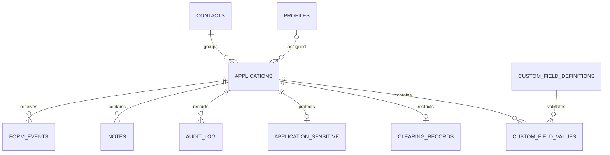

# Arquitectura y decisiones

La aplicación Next.js separa interfaz cliente, acceso Supabase con JWT/RLS y rutas servidor para alta de usuarios e integración firmada. No requiere alterar el cotizador. Contrato HTTP validado con Zod; PostgreSQL aplica restricciones y transacciones independientemente de la UI.

La identidad compartida se representa con un contacto canónico; cada solicitud mantiene su snapshot de datos de contacto y, desde 007, CI accesible al vendedor asignado. Evita que editar un caso cambie silenciosamente otro caso del mismo contacto. La conciliación entre contactos provisionales requiere una herramienta administrativa futura y nunca se ejecuta automáticamente por PII.

Migraciones: 001 entidades, estados, índices, RLS y auditoría; 002 recepción transaccional idempotente; 003 validación tipada de campos; 004 límite distribuido de recepción y fechas de notas controladas por servidor; 005 orígenes; 006 ejes comercial/garantía y auditoría completa; 007 CI, tipos de comentarios y marketing; 008 registro de emisión independiente de la etapa aprobada; 009 evidencia histórica desconocida explícita; 010 seguimiento programado al finalizar; 011 correcciones de la auditoría de seguridad (identificador web oculto, paridad del guard en altas, cuarentena de eventos web tardíos); 012 WhatsApp (conversaciones, mensajes, cola de envíos y configuración; ver WHATSAPP.md); 013 documentos de WhatsApp a Google Drive y carpeta automática por caso; 014 asistente de WhatsApp con IA; 015 renombrar la carpeta de Drive del caso cuando llega la CI y aceptar CI con espacios. Aplicar en orden; no ejecutar bootstrap de tests en Supabase real.

Roles: administrador ve todos los casos y datos sensibles; vendedor solo asignados. Restricción de columnas mediante tablas separadas (no únicamente RLS). Trigger de solicitudes impide reasignaciones, cambios de decisión formal, completitud, procedencia y archivado por vendedores. RLS se consulta también con usuario desactivado; no depende de la sesión UI. Notas/auditoría son no destructivas para clientes ordinarios. Auditoría de estados y responsables conserva valores anterior/nuevo; la CI canónica se audita dentro del caso bajo sus permisos, mientras ingresos y motivos sensibles quedan en auditoría de administración.

## Estado de entrega

Implementación aislada utilizable, esquema probado en PostgreSQL, demo navegable. No equivale al MVP v1.3 completo ni a un servicio de producción. Pendientes: Supabase Auth/SMTP reales, conciliación manual de contactos y discrepancias, costos/ingresos para métricas financieras, agregados y búsquedas en servidor para gran volumen, adaptador/cola de origen, validación de backups y despliegue autorizado. No hay cambios a web o campañas.

El panel comparte un pipeline con dos vistas. Alertas por fecha local de Uruguay y último comentario; el orden de las tarjetas depende de actividad de cualquier tipo. Las estadísticas separan cohortes de ingreso, decisiones actuales, etapas previas al rechazo y actividad por autor. WhatsApp es una propuesta documentada; no existe un servicio de envío activo. Ver ONLINE-WEB-WHATSAPP.md.
