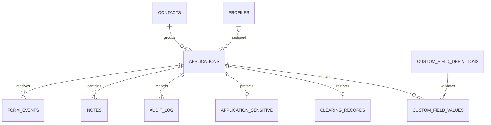

# Arquitectura y decisiones

La aplicación Next.js separa interfaz cliente, acceso Supabase con JWT/RLS y rutas servidor para alta de usuarios e integración firmada. No requiere alterar el cotizador. Contrato HTTP validado con Zod; PostgreSQL aplica restricciones y transacciones independientemente de la UI.

La identidad compartida se representa con un contacto canónico sin datos expuestos al vendedor; cada solicitud mantiene su snapshot de datos de contacto. Evita que editar un caso cambie silenciosamente otro caso del mismo contacto. La conciliación entre contactos provisionales requiere una herramienta administrativa futura y nunca se ejecuta automáticamente por PII.

Migraciones: 001 entidades, estados, índices, RLS y auditoría; 002 recepción transaccional idempotente; 003 validación tipada de campos; 004 límite distribuido de recepción y fechas de notas controladas por servidor. Aplicar en orden; no ejecutar bootstrap de tests en Supabase real.

Roles: administrador ve todos los casos y datos sensibles; vendedor solo asignados. Restricción de columnas mediante tablas separadas (no únicamente RLS). Trigger de solicitudes impide reasignaciones, cambios de decisión formal, completitud, procedencia y archivado por vendedores. RLS se consulta también con usuario desactivado; no depende de la sesión UI. Notas/auditoría son no destructivas para clientes ordinarios. Auditoría de estados y responsables conserva valores anterior/nuevo; valores de identidad no se duplican en auditoría general.

## Estado de entrega

Implementación aislada utilizable, esquema probado en PostgreSQL, demo navegable. No equivale al MVP v1.3 completo ni a un servicio de producción. Pendientes: Supabase Auth/SMTP reales, conciliación manual de contactos y discrepancias, filtros y métricas completos, paginación servidor, adaptador/cola de origen, validación de backups y despliegue autorizado. No hay cambios a web o campañas.
