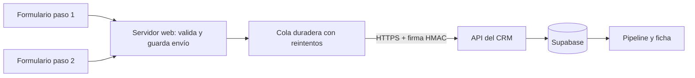

# Publicar el CRM, conectar la web y sumar WhatsApp

Estado de esta entrega: el panel y el receptor de formularios están desarrollados. La demo usa datos ficticios en el navegador. No se publicaron servicios, no se modificó garantiaporto.com.uy y no se activó WhatsApp. Esta guía describe los pasos de puesta en producción y las decisiones pendientes.

## 1. Qué necesitás para usarlo online

La opción recomendada es **Vercel para el CRM + Supabase para usuarios y base de datos + un subdominio como crm.garantiaporto.com.uy**. También funciona en un servidor con Node.js y HTTPS. El sitio comercial puede seguir alojado donde está.

| Componente | Para qué sirve | Configuración necesaria |
| --- | --- | --- |
| Hosting de Next.js | Publica el panel y el receptor de eventos | Conectar repositorio y rama elegida; Node 24 usado en pruebas; `npm ci`, `npm run build`, `npm run start` en servidor propio |
| Supabase PostgreSQL y Auth | Guarda información compartida y autentica al equipo | Proyectos separados de pruebas/producción; ejecutar migraciones 001 a 012 en orden; backups y restauración probados |
| Dominio y HTTPS | Acceso desde cualquier equipo | DNS del subdominio y certificado; URL final exacta en Auth y recuperación de contraseña |
| Correo transaccional | Recuperación de acceso | SMTP propio; dominio verificado; probar recuperación de una cuenta ficticia |
| Administración | Gestiona accesos | Crear el primer usuario en Supabase Auth y su perfil admin con procedimiento restringido; desactivar registro público; después altas desde Equipo |
| Operación | Evita pérdida de información | Responsable de soporte, monitoreo, alertas técnicas, presupuesto, actualizaciones y retención de datos |

Variables según `.env.example`: `NEXT_PUBLIC_SUPABASE_URL` y `NEXT_PUBLIC_SUPABASE_ANON_KEY` son las del cliente público protegido por RLS. `SUPABASE_SERVICE_ROLE_KEY` y `CRM_WEBHOOK_SECRET` son **secretos de servidor**, nunca llevan prefijo NEXT_PUBLIC, nunca van en HTML, JavaScript del sitio, Git ni capturas. Configurarlas en el gestor de secretos del hosting. `CRM_INTEGRATION_ENABLED=false` hasta completar el ensayo del emisor.

La demo **no sirve para almacenar clientes reales**: sus datos y cambio de rol son locales y no constituyen autenticación. No basta con subir la demo para tener un CRM privado. Para producción se debe comprobar que aparece el login real, que cada usuario ve solo lo permitido y que los registros persisten entre dos equipos distintos. No importar el localStorage de pruebas como datos reales.

La tipografía adjunta tiene licencia trial/personal: reemplazarla por archivos con licencia web comercial antes de publicar. Los precios de hosting, backups, WhatsApp y modelo dependen de los planes y uso; no se presupuestaron importes sin esos datos.

## 2. Seguridad: qué está cubierto y qué falta validar

| Riesgo | Protección implementada | Paso necesario para producción |
| --- | --- | --- |
| Un vendedor accede a clientes ajenos | RLS de PostgreSQL por usuario activo/asignación; permisos separados de admin, ingresos y Clearing | Ejecutar las pruebas también con cuentas reales de staging y HTTP/Supabase Auth; las pruebas locales emulan JWT en PostgreSQL |
| Cédulas expuestas | CI solo en solicitudes accesibles por RLS; histórico de cambios | Confirmar política interna: vendedor asignado puede verla; evitar exportaciones/capturas con PII; definir retención y eliminación |
| Robo de cuentas o sesión | Login por Supabase, recuperación, bloqueo por perfil inactivo | Configurar MFA para admins y su exigencia efectiva; políticas de contraseñas, límites de login, expiración y dispositivos compartidos. MFA todavía no está integrado en la interfaz |
| Claves filtradas | Claves de servicio solo en rutas del servidor | Gestor de secretos, rotación, mínimo acceso a hosting y repositorio; no registrar cuerpos completos ni secretos en logs |
| Formularios falsos, repetidos o perdidos | HMAC, ventana temporal, límite de tamaño/tasa, idempotencia y transacciones | Cola duradera/reintentos en el emisor, vigilancia de fallos, conciliación diaria, rate limiting/WAF antes de la aplicación |
| Scripts maliciosos | React escapa texto, URLs de Drive restringidas y encabezados contra framing/sniffing | Añadir y probar CSP compatible con Next y Supabase; HSTS sobre el dominio HTTPS; revisar XSS, dependencias y extensiones de navegador. Las sesiones del cliente requieren especial cuidado ante XSS |
| Carpetas abiertas a cualquiera | Solo se guarda enlace HTTPS de carpeta; no se copian archivos al CRM | Drive privado, acceso por cuentas/grupos, nunca “cualquiera con el enlace”; probar permisos y revocación. El CRM no puede corregir los permisos de Drive |
| Pérdida de datos o caída | Migraciones y pruebas de persistencia/transacciones | Backups con retención acordada, restauración ensayada, alertas de indisponibilidad y plan de recuperación; no basta con tener backups habilitados |
| Demasiados datos en memoria | Lecturas paginadas para evitar truncar silenciosamente a 1.000 filas | Para una cartera grande, pasar búsquedas/agregados a consultas de servidor bajo RLS y medir carga; hoy el cliente carga su conjunto autorizado |

No se realizó una auditoría de penetración ni se probó el proveedor real de Auth/SMTP en esta entrega. La prueba `npm audit --omit=dev` no reportó vulnerabilidades conocidas el 3/11/2026; eso no certifica la seguridad del sistema. Antes de clientes reales: revisión de acceso, restauración, recuperación de contraseña y recepción de eventos en staging. Acordar consentimiento, acceso, rectificación, retención y tratamiento de datos personales conforme a la política de la empresa y normativa uruguaya aplicable.

## 3. Cómo conectar los dos pasos del formulario

Flujo recomendado:



1. Revisar el código real que procesa el formulario, no solamente el cotizador: plugin/hook de envío exitoso, nombres de campos, consentimientos, confirmación del paso 2 y conversiones de Ads. El usuario confirmó WordPress y formularios de Elementor Pro; falta inspeccionar cómo están construidos los dos pasos. Ver ELEMENTOR-WHATSAPP.md.
2. Crear un `solicitud_id` UUID al iniciar una solicitud y mantenerlo en **los dos pasos**. Un `event_id` UUID distinto por envío. Un reintento conserva el mismo event_id y cuerpo; solo renueva la firma temporal. No conciliar automáticamente por celular o cédula: un cliente puede tener varias solicitudes.
3. En el éxito del paso 1, guardar el envío y encolar el evento: crea el lead aunque no complete el segundo paso. En el éxito del paso 2, encolar otro evento con el mismo solicitud_id: completa el caso existente sin reiniciar su gestión. La integración tolera paso 2 antes que paso 1 y no degrada un caso completo si llega un paso 1 tardío.
4. Capturar y conservar parámetros UTM, identificadores de clic, URL, referente y botón desde la llegada y a través del popup/pasos. Mapear los nombres reales al contrato de `docs/INTEGRATION.md`; los campos adicionales van en `extra`. Revisar qué parámetros contienen datos personales y no copiar tokens de sesión o contraseñas a URLs/marketing.
5. El **servidor** de la web envía POST a `https://crm.DOMINIO/api/integration/events`. Firma exacta: HMAC-SHA256 de `timestamp + '.' + cuerpoJSON`, cabeceras `x-crm-timestamp` y `x-crm-signature`. El secreto solo reside en ambos servidores. No enviar desde el navegador con el secreto expuesto.
6. Cola con registro persistente: éxito 200 marca procesado; timeout/429/5xx reintenta con backoff y jitter, respetando Retry-After. 401/409/422 requieren revisión y alerta, no descartar el lead; guardar intento y error sin duplicar PII en logs. Tener bandeja de fallos y replay manual. El receptor por sí solo no recupera envíos que nunca recibió.
7. En staging comprobar: abandono tras paso 1, doble clic, ambos pasos, orden invertido, caída del CRM, reintentos, firma inválida, parámetros de campaña, consentimiento, discrepancias de datos y continuidad de correos/Ads. Luego activar el emisor y receptor coordinadamente, vigilar resultados y disponer de rollback que detenga el emisor conservando la cola.

Ejemplo de cuerpo ficticio (no enviar a producción):

```json
{
  "schema_version": 1,
  "event_id": "20000000-0000-4000-8000-000000000001",
  "solicitud_id": "30000000-0000-4000-8000-000000000001",
  "step": 1,
  "sent_at": "2026-11-03T15:00:00Z",
  "data": {
    "full_name": "Persona Ficticia",
    "phone": "000000000",
    "rent_amount": 25000,
    "rent_currency": "UYU",
    "utm_source": "google",
    "utm_medium": "cpc",
    "utm_campaign": "campana-ficticia",
    "button_origin": "cotizador",
    "source_url": "https://example.test/garantia"
  },
  "extra": { "variante_formulario": "A" }
}
```

El panel muestra la primera atribución informada por campo. Los eventos originales conservan valores posteriores, `extra`, diferencias y orden de recepción, con acceso de administración en Marketing. Si un campo desconocido llega dentro de `data`, el receptor devuelve 422 en vez de borrarlo silenciosamente; mapearlo a `extra` o ampliar el contrato. La CI puede faltar en el paso 1; si llega después en un formato válido completa la ficha. Una identidad conflictiva queda para revisión, no sustituye la corrección del equipo.

**Pendiente de implementación:** adaptador y cola del sitio real; captura exacta de campos después de inspeccionar el formulario; ensayo integrado y publicación. No se cambió la web en esta entrega. El CRM todavía requiere recargar para ver nuevos eventos externos; la actualización en tiempo real puede añadirse con Supabase Realtime y los mismos permisos.

## 4. Agente de atención por WhatsApp

Sí se puede hacer. La recomendación es usar **WhatsApp Business Platform / Cloud API oficial**, un servicio de conversación conectado al CRM y una base de respuestas aprobadas. Tener la app WhatsApp Business no significa tener habilitada la API. Hay que comprobar la cuenta empresarial de Meta, número, posibilidad de coexistencia con la app, permisos y proveedor. No conectar mediante automatizaciones de WhatsApp Web.

Para iniciar conversación a partir del formulario, necesitamos consentimiento verificable para ese contacto por WhatsApp y una plantilla aprobada cuando lo exija Meta. El envío de un formulario web no abre por sí mismo la ventana de atención de WhatsApp. Las respuestas libres dependen de la ventana vigente desde el mensaje del usuario; fuera de ella se usan plantillas conforme a las reglas actuales. Confirmar categorías, elegibilidad y precios en Meta/proveedor antes de contratar.

Arquitectura propuesta:

- Tras **confirmar** el alta en el CRM, registrar una tarea en una outbox transaccional. Un worker verifica consentimiento, número, horario y si ya existe una conversación antes de enviar el saludo. No depender de que alguien tenga el panel abierto.
- Recibir mensajes y estados de entrega mediante webhook oficial con validación de firma, deduplicación por ID y reintentos. Registrar conversación, autor humano/agente, entrega y errores. El primer mensaje del agente no cambia decisiones formales ni aprueba una garantía.
- El modelo consulta respuestas autorizadas de Garantía Porto y una lista de documentación por tipo de garantía. Herramientas mínimas: leer el caso autorizado, agregar comunicación, proponer datos para confirmar y derivar a un vendedor. Las funciones validan identidad/caso en servidor; nunca ejecutan SQL, URLs arbitrarias o instrucciones contenidas en mensajes/documentos.
- Pedir documentación con un canal seguro hacia Drive privado. Preferir enlace de carga restringido; si se aceptan adjuntos por WhatsApp, un servicio valida tamaño/tipo, analiza archivos y transfiere a Drive, sin guardarlos permanentemente en la base del CRM. Revisar también almacenamiento y retención de Meta y del proveedor del modelo: guardar en Drive no elimina las copias que terceros puedan tratar.
- Derivación humana visible con pausa efectiva del agente: dudas sobre aprobación/Clearing, reclamos, baja del consentimiento, incertidumbre o solicitud de una persona. Evitar dos respuestas simultáneas de vendedor y agente.
- No enviar CI, ingresos ni documentos completos al modelo sin una necesidad concreta y controles acordados. El agente no decide solvencia, aprobación, rechazo ni consulta Clearing por su cuenta. Respuestas con reglas y fuentes aprobadas; si no conoce la respuesta, deriva.
- Medir tiempo de primer contacto, entrega, respuestas, documentos pendientes, derivaciones y costo. El evento de comunicación efectiva debe integrarse con el historial y las alertas; un mensaje en cola o fallido no cuenta como contacto exitoso.

Etapas sugeridas: (1) saludo aprobado + derivación humana; (2) preguntas frecuentes y checklist de documentos en sandbox; (3) agente con herramientas limitadas, revisión y piloto pequeño; (4) ampliación con métricas y botón de apagado. No se implementó ni se activó automatización en esta entrega: tu pedido sobre WhatsApp es de diseño y viabilidad.

Datos confirmados: Elementor Pro y WhatsApp Business con portfolio comercial, sin API habilitada. Ver [guía específica](ELEMENTOR-WHATSAPP.md). Datos que faltan: exportación/configuración del formulario y acceso técnico mediante un canal seguro; disponibilidad de dominio/hosting/Supabase; decisión sobre conservar el número/app mediante coexistencia o utilizar otro número; consentimiento actual; lista de documentos por garantía y preguntas/respuestas autorizadas; quién toma las derivaciones y horarios. No compartir claves privadas por el chat.

Referencias oficiales para configurar y verificar requisitos vigentes: [Supabase en producción](https://supabase.com/docs/guides/platform/going-into-prod), [Supabase RLS](https://supabase.com/docs/guides/database/postgres/row-level-security), [Next.js en Vercel](https://vercel.com/docs/frameworks/full-stack/nextjs), [WhatsApp Cloud API](https://developers.facebook.com/docs/whatsapp/cloud-api/), [Política de mensajería de WhatsApp](https://business.whatsapp.com/policy). Estos enlaces son referencias; no se verificaron tarifas ni habilitación de tu cuenta en esta entrega.
